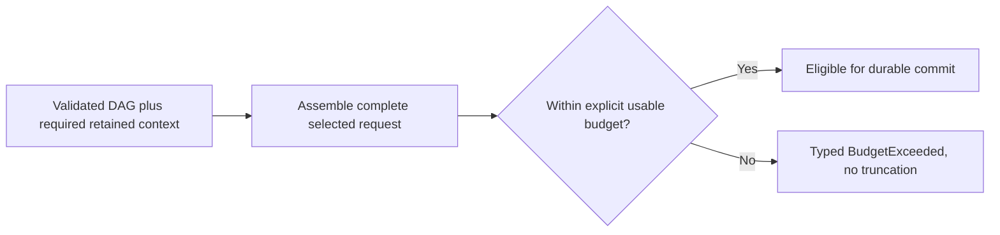

<!-- card: {"id":"CMPCT-071","type":"story","priority":"P1","findings":"CB-20","dependsOn":["CMPCT-065","CMPCT-070","CMPCT-082"]} -->
# CMPCT-071: Require whole-request fit or bounded typed failure before DAG commit

## Confirmation

**Confirmed admission capability gap; actual residual overflow is conditional.**
`rust/agent-loop/src/generate_compaction_handler.rs:120` bounds builder runtime,
not the resulting wire request. Pin sites at
`rust/cli/src/compactor_sub_agent.rs:119`,
`rust/agent-loop/src/inject_summary_handler.rs:292` and
`rust/agent-loop/src/generate_compaction_handler.rs:773` lack a final whole-request
fit veto. Small DAG text alone cannot bound mandatory reminders/schema/overhead.

## Acceptance criteria

- Before committing/claiming fit, admit the complete selected provider request:
  instructions, DAG, verified suffix, tool schemas, media and output reservation.
- Require explicit usable limits and honest measurement/estimation provenance;
  a builder depth/time bound or reduction percentage is not a fit certificate.
- If fixed instructions or a valid candidate cannot fit, terminate with typed
  blocked failure preserving state; no truncation, partial salvage or forced shrink.

## Regression scenarios

- Given mandatory fixed context already above capacity, when compaction is requested,
  then it terminates boundedly without replacement, alternate memory or completion.
- Given a small valid DAG plus large schema/suffix overhead, when full request
  admission runs, then it rejects oversize and admits a genuinely fitting request.

## Coding notes

Share request serialization/admission with physical-send guards. Distinguish
trigger threshold from hard capacity and keep estimates explicitly estimated.
This is a story because full admission is a missing stronger contract, not proof
every existing candidate fails. CMPCT-079 removes the existing fallback-success
conversion; this card never promises guaranteed successful compaction.

Mandatory companion: `00-shared-contract.md`. Research: CB-20 in
`compaction-research/compaction-bugs/04-builders-and-convergence.md`.
