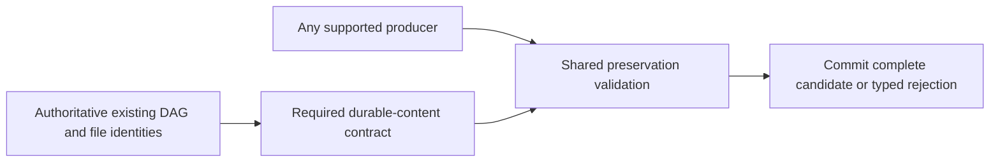

<!-- card: {"id":"CMPCT-072","type":"bug","priority":"P2","findings":"CB-21","dependsOn":["CMPCT-055","CMPCT-070"]} -->
# CMPCT-072: Enforce durable-node and file-awareness preservation on every DAG route

## Confirmation

**Confirmed route asymmetry; actual missing durable content depends on the candidate.**
`rust/agent-loop/src/inject_summary_handler.rs:262` repairs absent file metadata
only when literal `<dag-files>` is missing, so malformed/empty blocks bypass it.
Direct pins at `rust/cli/src/compactor_sub_agent.rs:119` and
`rust/agent-loop/src/generate_compaction_handler.rs:773` lack equivalent handling.
Normal self-lock contention substitutes `existing_dag=None` at `:608`, selecting
fresh rather than incremental instructions. Prompt preservation is not validation.

## Acceptance criteria

- Define authoritative durable D2 content, required reminders and file-awareness
  identities once, then enforce that contract across all supported commit routes.
- Capture existing DAG authoritatively; inaccessible state is a typed source failure,
  not permission for a fresh rebuild that omits old durable nodes.
- Reject incomplete/malformed required metadata before commit; no post-failure
  fragment repair, guessed file awareness or route-specific substitute success.

## Regression scenarios

- Given durable nodes/file IDs, when deferred, direct, self and cross candidates
  commit, then required content is preserved according to one validation contract.
- Given self-source contention or malformed/empty dag-files, when submission runs,
  then it fails without dropping previous D2/file awareness or inventing a fresh DAG.

## Coding notes

HITL decision: preserve authoritative D2 payloads and required reminder identities
unchanged. Assemble file metadata deterministically from authoritative state before
validation. Do not accept semantically equivalent rewrites of durable payloads.

Deterministically assembling declared metadata from authoritative source is normal
selected-protocol behavior, not rescue of a failed candidate. Decide that assembly
before validation and apply it uniformly. Preserve required reminders, not every
arbitrary reminder forever. Inspect partitioning at
`rust/cli/src/session/system_reminders.rs:55`; align source ownership with CMPCT-055.

Mandatory companion: `00-shared-contract.md`. Research: CB-21 in
`compaction-research/compaction-bugs/04-builders-and-convergence.md`.
