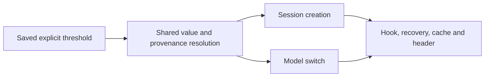

<!-- card: {"id":"CMPCT-073","type":"bug","priority":"P2","findings":"CB-22","dependsOn":[]} -->
# CMPCT-073: Propagate saved threshold overrides through creation and model switching

## Confirmation

**Confirmed cached-limit wiring defect, not universal guard misconfiguration.**
`rust/sessions/src/profile_persistence.rs:211` saves compactionThreshold.
Creation at `rust/sessions/src/session_creation_helper.rs:300` and switching at
`rust/sessions/src/handle_impl.rs:1493` pass None to the override-aware resolver.
`rust/cli/src/compaction_threshold.rs:198` honors a supplied override, and streaming
at `rust/cli/src/interactive/stream_loop.rs:274` does supply one on another path.

## Acceptance criteria

- Resolve saved explicit threshold configuration through session creation, switch,
  hook/recovery and cached/header limits with shared value and provenance.
- Keep trigger threshold distinct from hard capacity and output reservation;
  the same model/profile override must not silently disappear on a cached path.
- Invalid or unresolved explicit configuration fails clearly; no guessed default
  or fallback limit may conceal a resolution failure.

## Regression scenarios

- Given a saved override distinct from built-in defaults, when a session is created,
  then its cached/header threshold and active policy resolve the intended value.
- Given a switch to another overridden model, when limits refresh, then the new
  override propagates and the old threshold cannot remain in hook/UI state.

## Coding notes

Trace persisted profile loading, runtime model configuration and resolver callers
end-to-end; resolver unit tests alone cannot catch omitted arguments. Cover token
and percentage overrides and explicit invalid values. CMPCT-082 owns removing
resolution fallback semantics; this card owns carrying the actual configuration.

Mandatory companion: `00-shared-contract.md`. Research: CB-22 in
`compaction-research/compaction-bugs/04-builders-and-convergence.md`.
