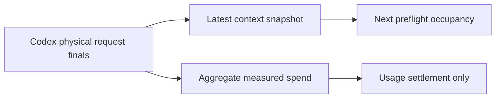

<!-- card: {"id":"CMPCT-074","type":"bug","priority":"P1","findings":"CB-23","dependsOn":["CMPCT-065"],"related":["RIG-011"]} -->
# CMPCT-074: Keep Codex aggregate spend out of the hook's current-context slot

## Confirmation

**Confirmed cross-layer usage mismatch; premature trigger is conditional.**
`rust/providers/src/codex/streaming.rs:128` emits per-request Usage and accumulates
it; `:152` returns the aggregate FinalResponse after internal continuations.
`rust/core/src/compaction_hook.rs:254` stores final usage as last per-request state;
`:217` uses that total for the next preflight. Multiple requests can thus become
one apparent occupancy. A false trigger requires aggregate crossing the threshold.

## Acceptance criteria

- Preserve total physical-request spend, but expose a separate latest-request/
  committed-generation occupancy snapshot to the hook and context-fill consumers.
- Bind occupancy to request/model/generation so previous continuation or pre-DAG
  aggregate cannot veto a new fitting context.
- Unknown usage remains explicit; no dropping billable segments, guessed context
  or fallback compaction to compensate for mixed accounting bases.

## Regression scenarios

- Given two internal Codex requests each individually fitting but whose usage sum
  exceeds threshold, when a later preflight runs, then aggregate spend alone cannot cancel it.
- Given actual latest context above threshold, when normalized usage reaches the
  hook, then admission blocks correctly while all measured spend remains retained.

## Coding notes

Test the Responses stream through the hook, not just arithmetic helpers. Include
cache/reasoning overlap fixtures after CMPCT-065 and a committed-generation change.
Do not substitute provider-native compaction or discard aggregate billing. The
outer Rig tool loop may aggregate again, so make field bases explicit at its boundary.

Mandatory companion: `00-shared-contract.md`. Research: CB-23 in
`compaction-research/compaction-bugs/05-codex-specific-findings.md`.
