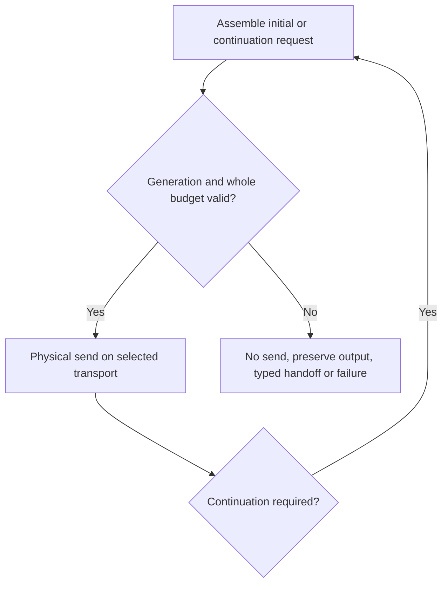

<!-- card: {"id":"CMPCT-075","type":"bug","priority":"P1","findings":"CB-24","dependsOn":["CMPCT-071","CMPCT-074"]} -->
# CMPCT-075: Guard every Codex continuation's complete physical request

## Confirmation

**Confirmed missing fresh outer admission; overflow requires growing continuation.**
`rust/providers/src/codex/streaming.rs:71` loops through initial request plus up to
three continuations. At `:136`, replay loops directly without another outer hook.
`rust/providers/src/codex/lifecycle.rs:134` appends replayable assistant output.
The request can grow after initial admission. Separate HTTP retries mean four
logical stream requests are not necessarily a four-send physical bound.

## Acceptance criteria

- Admit every actual serialized continuation request against explicit limits,
  normalized current occupancy and generation before sending.
- Preserve prior measured output and request lineage when continuation is rejected;
  return typed blocked failure or explicitly stop the internal loop for an owned
  DAG handoff. Resume only after validated durable commit and fresh admission,
  preserving genuine tool outcomes; no automatic recovery/Continue route.
- No unguarded send, truncation, native memory activation, transport downgrade or
  delta/full substitution may rescue a rejected continuation.

## Regression scenarios

- Given an initially fitting request and growing continuation, when the next request
  would exceed its budget, then the transport observes no oversized send.
- Given admitted continuation and declared same-transport transient retry, when
  requests are captured, then each send preserves the admitted generation/content contract.

## Coding notes

Use actual wire assembly shared with CMPCT-071, not a text-only heuristic that
ignores schemas/reminders. A provider-internal loop must expose an admission/
handoff boundary instead of relying on the caller to guess internal growth.
Test completed/end_turn=false and interrupted-incomplete fixtures; tool calls
change continuation conditions and must retain valid pairing.

Mandatory companion: `00-shared-contract.md`. Research: CB-24 in
`compaction-research/compaction-bugs/05-codex-specific-findings.md`.
