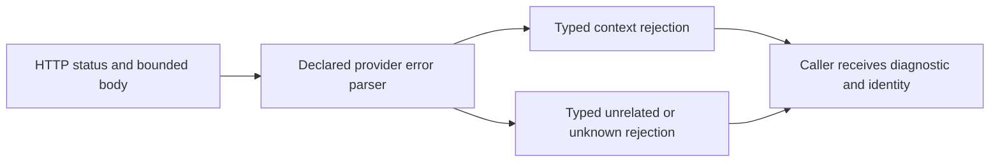

<!-- card: {"id":"CMPCT-076","type":"bug","priority":"P1","findings":"CB-25","dependsOn":[]} -->
# CMPCT-076: Preserve typed Codex HTTP rejection diagnostics in streaming errors

## Confirmation

**Confirmed information loss on the default HTTP streaming path.**
`rust/providers/src/codex/recovery.rs:137` returns a fixed status/rejection error
without reading the response body, including nonretryable first-attempt 400/413.
Non-streaming at `rust/providers/src/codex/model.rs:182` retains the body;
SSE terminal diagnostics at `rust/providers/src/codex/lifecycle.rs:69` retain
provider code/message. Not every 400 or 413 is a context overflow.

## Acceptance criteria

- Preserve bounded diagnostic body, status, declared provider code and retry metadata
  in a typed error without leaking credentials or sensitive transport headers.
- Use the provider adapter's declared parser to distinguish context rejection,
  unrelated configuration/request errors and unknown outcomes.
- Unknown/unrelated rejection fails explicitly; no generic token-substring rescue,
  alternate transport, native compaction or successful recovery claim.

## Regression scenarios

- Given HTTP 400/413 with a declared context code, when streaming rejects the request,
  then typed context diagnostics survive to admission/recovery handling.
- Given unrelated 400, malformed/oversized body or SSE terminal error, when parsed,
  then classification remains accurate/explicitly unknown and diagnostics stay bounded.

## Coding notes

Use scripted HTTP and SSE fixtures through the real client. Apply the same error
contract across initial and exhausted retry responses, keeping request identity.
Do not infer overflow solely from status. Preserve raw bounded evidence separately
from classification; CMPCT-082 removes broad fallback classifiers at callers.

Mandatory companion: `00-shared-contract.md`. Research: CB-25 in
`compaction-research/compaction-bugs/05-codex-specific-findings.md`.
