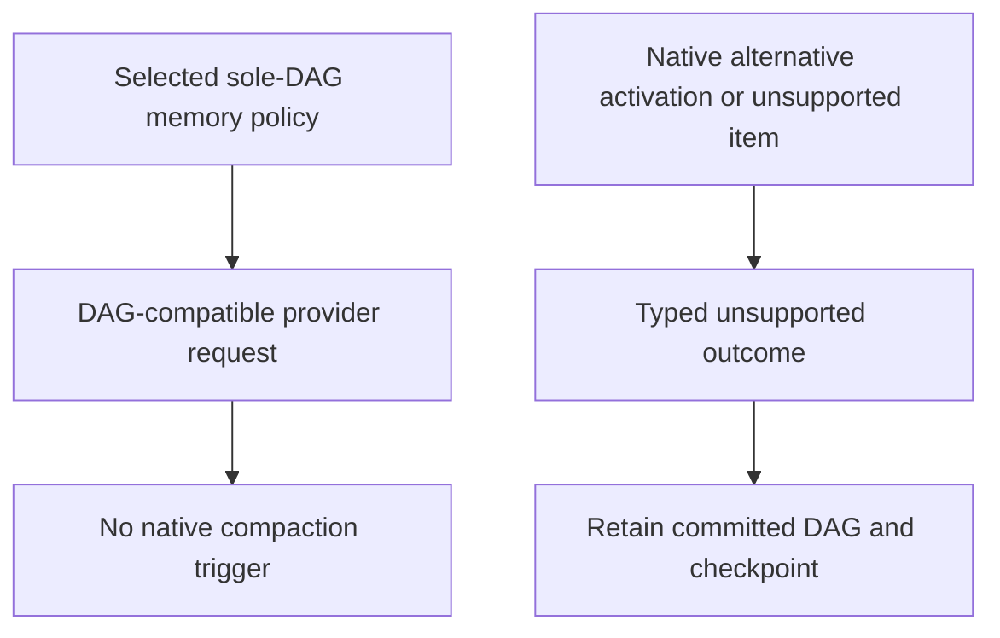

<!-- card: {"id":"CMPCT-077","type":"story","priority":"P1","findings":"CB-26","dependsOn":[]} -->
# CMPCT-077: Enforce sole-DAG policy by removing alternate native memory activation

## Confirmation

**Capability/policy gap, not a default-enabled native compaction incident.**
Flags default false at `rust/providers/src/codex/native.rs:5` and
`rust/providers/src/codex/model.rs:84`. An enabling setter exists at `:49`;
native preparation at `native.rs:21` can append triggers without a complete generic
DAG lifecycle. Streaming and non-streaming item validation differ. No native
lifecycle implementation or DAG-versus-native benchmark is requested.

## Acceptance criteria

- Remove native compaction activation options and implementation paths entirely;
  do not retain a rejection-only option or activate native/flat/hybrid alternatives.
- Unsupported native memory items or activation return explicit typed unsupported
  outcomes without mutating the committed DAG/checkpoint or publishing completion.
- Preserve legitimate non-compaction provider features only through explicit
  separate contracts; do not equate every encrypted provider item with compaction.

## Regression scenarios

- Given default constructors and a failed DAG operation, when the next request is
  inspected, then no native compaction trigger or alternate memory request appears.
- Given attempted native activation or unsolicited unsupported compaction item,
  when processed, then the outcome is typed unsupported and committed state is unchanged.

## Coding notes

Human HITL decision: remove unsupported activation surfaces entirely; do not complete
the native lifecycle to repair this gap. Audit config, constructor, wire-build,
stream and non-stream routes. Distinguish compaction items from encrypted reasoning.
Keep the research-backed fspec DAG, same-agent ownership and immutable retrieval.
This is a story because the selected policy tightens an opt-in capability boundary.

Mandatory companion: `00-shared-contract.md`. Research: CB-26 in
`compaction-research/compaction-bugs/05-codex-specific-findings.md`.
