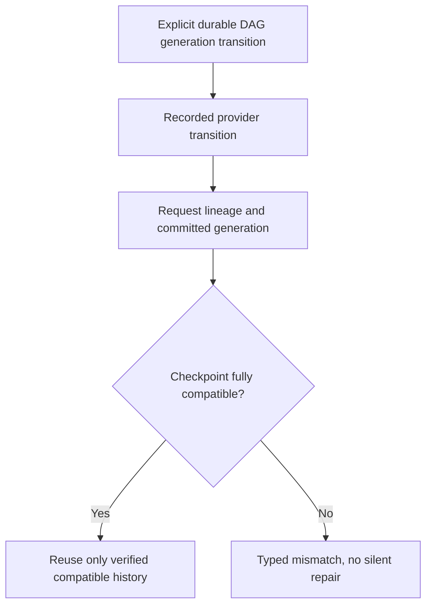

<!-- card: {"id":"CMPCT-078","type":"bug","priority":"P1","findings":"CB-27","dependsOn":["CMPCT-055"]} -->
# CMPCT-078: Bind Codex continuation checkpoints to full committed lineage

## Confirmation

**Confirmed weak continuity check; stale resurrection requires changed non-user history.**
`rust/providers/src/codex/history.rs:85` validates model and user ancestry only.
At `:108`, saved non-reminder assistant/tool items can be reused even when incoming
non-user lineage changed. The DAG special case at `:99` applies only to empty
previous user ancestry. A reset exists at `rust/providers/src/codex/session.rs:46`;
this is not proof every ordinary DAG commit currently resurrects stale history.

## Acceptance criteria

- Validate model/protocol identity, committed DAG generation and full relevant
  assistant/tool ancestry before reusing a provider checkpoint.
- DAG installation performs an explicit recorded durable generation transition;
  compatible suffix work survives and old checkpoint content cannot reappear.
- Incompatibility returns typed failure or uses the preselected full-current-DAG
  protocol after its recorded commit-time reset; never error-driven silent repair.

## Regression scenarios

- Given the same user prefix but changed assistant/tool history, when checkpoint
  reuse is requested, then stale saved non-user content is not sent.
- Given a valid committed DAG transition plus suffix and a cold resume, when another
  Codex request is built, then it references only the compatible generation.

## Coding notes

Separate full-current-DAG mode from optional generation-bound delta mode before
request construction. A mismatch must not itself trigger reset/full-input rescue.
Coordinate durable checkpoint handling with CMPCT-080 and generic commit with
CMPCT-059. Use captured actual request bodies, not merely checkpoint object equality.

Mandatory companion: `00-shared-contract.md`. Research: CB-27 in
`compaction-research/compaction-bugs/05-codex-specific-findings.md`.
