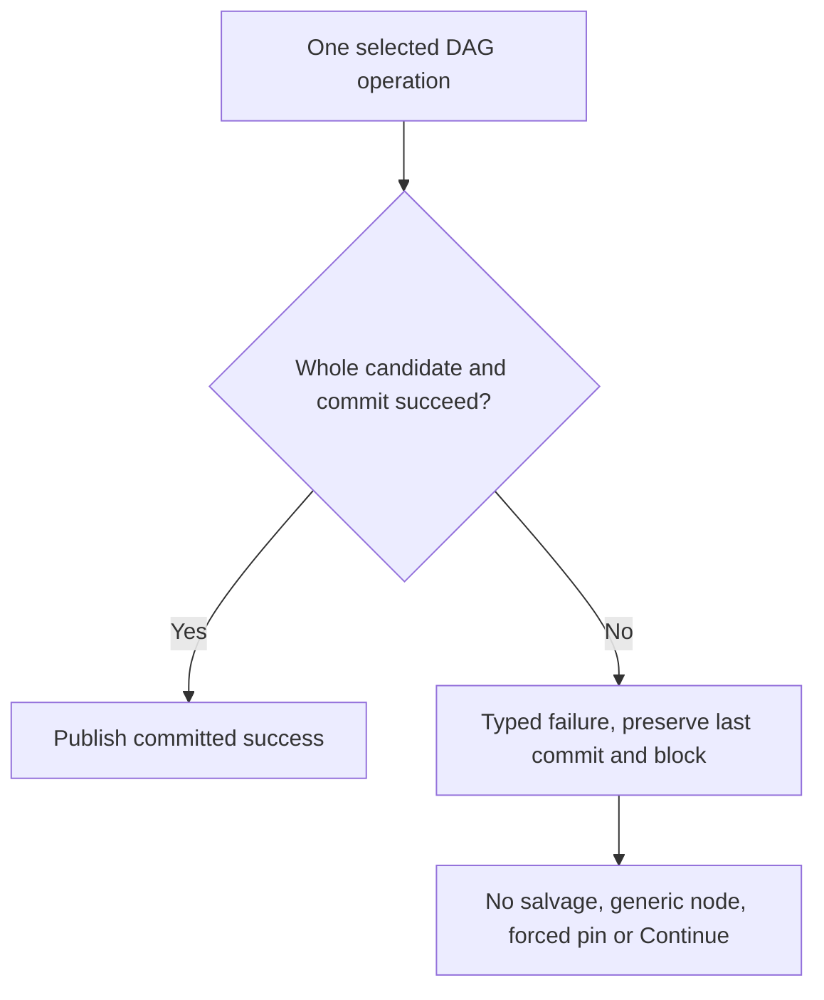

<!-- card: {"id":"CMPCT-079","type":"bug","priority":"P1","findings":"CB-28/runtime","dependsOn":["CMPCT-053","CMPCT-054","CMPCT-055","CMPCT-070","CMPCT-071","CMPCT-072"]} -->
# CMPCT-079: Remove runtime fallback DAGs, partial salvage and forced continuation

## Confirmation

**Confirmed executable conflict with the latest no-fallback requirement.**
`rust/cli/src/compactor_sub_agent.rs:173` converts missing/failed builders to fallback
at `:223`, emits failure and completion, and returns Ok. Recovery helpers at
`rust/cli/src/compaction_dag.rs:231` salvage blocks or fabricate generic nodes.
GenerateCompaction converts error/invalid output at
`rust/agent-loop/src/generate_compaction_handler.rs:703`; watchdog at
`rust/agent-loop/src/agent_loop.rs:1484` synthesizes Continue then forces a pin.
These were historically intentional, not violations of their original completed cards.

## Acceptance criteria

- Remove every production error-to-substitute-DAG route, including extraction from
  diagnostics, generic nodes, truncation, forced injection and synthetic Continue.
- Propagate typed handler/source/timeout/depth/provider/validation/commit failure
  through automatic, tool, self, cross, watchdog and terminal paths without success.
- Preserve committed memory and block unsafe inference; remove obsolete helpers
  and replace fallback-success expectations. Builder working-view clearing must
  not mutate authoritative DAG/checkpoint/suffix before validated durable promotion.

## Regression scenarios

- Given missing/poisoned registry or builder timeout/depth/provider failure containing
  valid-looking DAG text, when handled, then no candidate is extracted or pinned.
- Given invalid output or watchdog exhaustion in each producer, when it terminates,
  then no synthetic Continue, completion, alternate request or committed-state mutation occurs.
- Given a builder paused after preparatory prompt clearing, when it times out or
  is cancelled, then the authoritative previous DAG/checkpoint and suffix remain
  intact and ordinary inference stays blocked until explicit resolution.

## Coding notes

Build a branch-by-branch removal checklist from CB-28, not a search for one function
name. Shared validator/fit/preservation precede removal so failure stays honest.
Scope watchdog deadline bookkeeping to CMPCT-057; this card removes its forced
producer. Preserve same-agent semantic ownership; builder failure is not license
to switch algorithms. Supersede CMPCT-016/020/047 fallback acceptance explicitly.

Mandatory companion: `00-shared-contract.md`. Research:
`compaction-research/compaction-bugs/08-no-fallback-removal-plan.md`.
