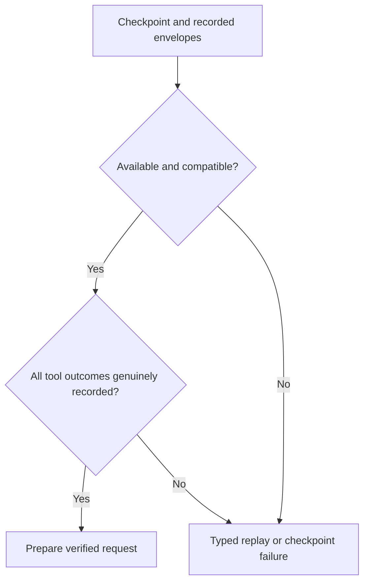

<!-- card: {"id":"CMPCT-080","type":"bug","priority":"P1","findings":"CB-28/replay","dependsOn":["CMPCT-055","CMPCT-064","CMPCT-078"],"related":["PROV-050"]} -->
# CMPCT-080: Remove silent checkpoint repair and fabricated replay tool results

## Confirmation

**Confirmed executable fallback/policy conflict on supported checkpoint paths.**
`rust/providers/src/codex/history.rs:41` masks poisoned lock as absent snapshot;
`:45` filters unsupported version; `:57` can mask inaccessible writer and `:69`
only logs reset persistence failure. Prepare at `:78`/`:104` repairs incoming
history on missing/mismatched state. Commit at `:174` mutates memory before saving.
`rust/providers/src/codex/history_replay.rs:74` invents a cancelled-tool result
when no actual result is recorded. These do not establish an actual cancellation.

## Acceptance criteria

- Distinguish genuinely absent checkpoint from inaccessible, unsupported, mismatched
  or failed-to-persist state; propagate typed outcomes through public restore/reset.
- Only a validated recorded generation transition may change checkpoint ancestry;
  failed persistence leaves previous committed memory/checkpoint authoritative.
- Replay uses real result/cancellation records. Missing pairs return explicit replay
  failure, never fabricated text, silent archive reconstruction or weakened continuity.

## Regression scenarios

- Given poisoned checkpoint/writer state, unsupported version or reset-save failure,
  when restore/prepare/commit runs, then it cannot succeed as absent/fresh state.
- Given a tool call without an actual result/cancellation record, when replay builds
  a request, then it fails without sending invented tool output or changing the checkpoint.

## Coding notes

Audit all callers of snapshot/restore/reset and writer installation, not only return
types. Missing checkpoint on a truly new session is legitimate; do not reject that
case. Existing session replay must retain generation and pair invariants. Use
real stores, lock-poison fixtures where supported and scripted request capture.
Coordinate transaction promotion with CMPCT-064 and lineage with CMPCT-078.

Mandatory companion: `00-shared-contract.md`. Research:
`compaction-research/compaction-bugs/08-no-fallback-removal-plan.md`.
