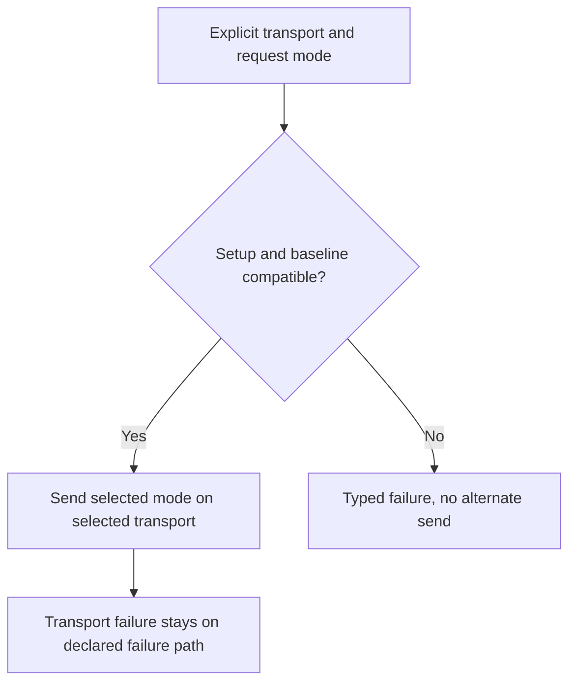

<!-- card: {"id":"CMPCT-081","type":"bug","priority":"P1","findings":"CB-28/transport","dependsOn":["CMPCT-055","CMPCT-078"]} -->
# CMPCT-081: Remove automatic Codex WS downgrade and delta-to-full mode fallback

## Confirmation

**Confirmed policy conflict conditional on selected WS/delta behavior.**
`rust/providers/src/codex/websocket.rs:144` converts upgrade 404/405/426/501 to
None; `rust/providers/src/codex/client_http.rs:121` automatically sends HTTP.
Other setup/send/stream errors already fail. Separately,
`rust/providers/src/codex/websocket_baseline.rs:46` leaves a full request when
baseline compatibility fails instead of rejecting incompatible delta mode.
This full-input behavior is same-socket encoding, not proof of raw-history resurrection.

## Acceptance criteria

- Configured WS fails with typed transport diagnostics on rejected upgrade; zero
  automatic HTTP attempts or other transport/model changes follow failure.
- Support explicit full-current-DAG requests only. Remove delta mode and its
  baseline bootstrap/downgrade paths rather than silently selecting full input.
- Preserve committed lineage and declared same-transport retry semantics. Explicit
  full mode's first request is valid and must not be confused with fallback.

## Regression scenarios

- Given configured WS returning each of 404/405/426/501, when connecting, then
  typed failure occurs and the HTTP fixture records zero fallback requests.
- Given a removed delta-mode configuration, when requests are prepared, then
  unsupported mode sends nothing and explicitly selected full mode works.

## Coding notes

Make selected mode/transport observable in configuration and request traces.
The human selected full-current-DAG-only mode through HITL. Remove delta selection
and baseline establishment rather than hiding implicit downgrades in helpers.
Test send/stream failure too so no replacement retry path is accidentally added.
Remove or replace old downgrade-success scenarios/tests in this implementation slice.

Mandatory companion: `00-shared-contract.md`. Research:
`compaction-research/compaction-bugs/08-no-fallback-removal-plan.md`.
