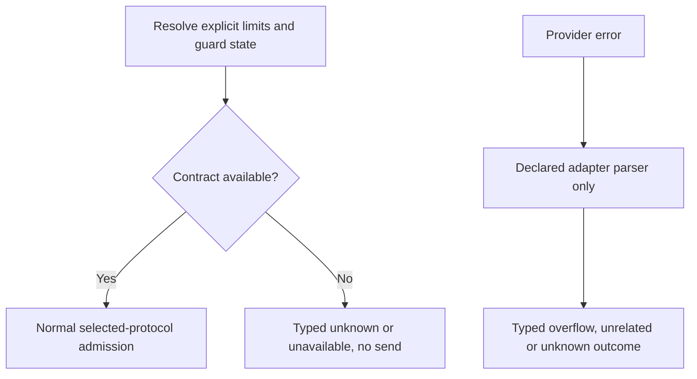

<!-- card: {"id":"CMPCT-082","type":"bug","priority":"P1","findings":"CB-28/admission","dependsOn":["CMPCT-076"]} -->
# CMPCT-082: Remove guessed limits, fail-open guards and broad recovery classifiers

## Confirmation

**Confirmed executable conflicts with explicit no-fallback admission.**
`rust/cli/src/compaction_threshold.rs:94` substitutes a 32000 output reservation
when unknown; `rust/providers/src/codex/mod.rs:120` supplies default provider
limits when registry data is absent. `rust/core/src/compaction_hook.rs:196`
skips checking on poisoned state. Generic classifier at
`rust/cli/src/interactive/error_classifiers.rs:50` scans error-chain strings,
including broad invalid_request_error plus token/maximum matches. Current behavior
was deliberate; these routes now conflict with the selected explicit contract.

## Acceptance criteria

- Require resolved explicit/authoritative limits with provenance; unknown output/
  context capacity fails or requires explicit configuration, never guessed fallback.
- Unavailable guard/state blocks physical inference with typed failure; no poisoned
  lock skip, fabricated zero usage or resolver failure hidden as usable defaults.
- Adapters provide declared typed error parsing. Unknown failures stay unknown;
  remove broad secondary classifiers that rescue them into compaction/strategy switching.

## Regression scenarios

- Given missing registry/model limits, invalid explicit configuration or poisoned
  admission state, when sending is requested, then no physical request is sent.
- Given unrelated invalid_request_error text mentioning tokens/maximum, when recovery
  routes it, then it does not trigger compaction; a declared typed overflow still does.

## Coding notes

Explicit user-selected reservation is valid configuration; absence-masking defaults
are not. A declared estimator with labeled uncertainty is not a guessed model limit.
Audit all provider/custom/stub admission consumers and classify unknown capability
honestly; this is not a mandate to remove unrelated benign Option defaults.
CMPCT-076 supplies Codex diagnostic preservation. Test zero-send assertions and
propagate fallible guard results through existing hook/cancellation interfaces.

Mandatory companion: `00-shared-contract.md`. Research:
`compaction-research/compaction-bugs/08-no-fallback-removal-plan.md`.
