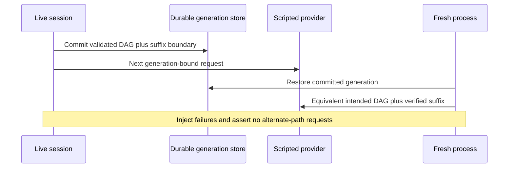

<!-- card: {"id":"CMPCT-083","type":"story","priority":"P1","findings":"CB-01–28 acceptance gate","dependsOn":["CMPCT-052","CMPCT-053","CMPCT-054","CMPCT-055","CMPCT-056","CMPCT-057","CMPCT-058","CMPCT-059","CMPCT-060","CMPCT-061","CMPCT-062","CMPCT-063","CMPCT-064","CMPCT-065","CMPCT-066","CMPCT-067","CMPCT-068","CMPCT-069","CMPCT-070","CMPCT-071","CMPCT-072","CMPCT-073","CMPCT-074","CMPCT-075","CMPCT-076","CMPCT-077","CMPCT-078","CMPCT-079","CMPCT-080","CMPCT-081","CMPCT-082"]} -->
# CMPCT-083: Gate compaction repair on cold-resume and no-fallback end-to-end tests

## Confirmation

**New cross-cutting acceptance coverage, not another independently observed bug.**
Existing component tests do not by themselves prove the combined lifecycle.
The required sequence and initial target inventory are in
`compaction-research/compaction-bugs/07-verification-priorities.md`.
The authoritative incident at
`compaction-research/current-state/12-incident-and-evidence.md` demonstrates why
completion notices alone are insufficient. No new test has been run for these cards.

## Acceptance criteria

- Verify live stream → submitted candidate → durable commit → next physical
  request → fresh-process resume → another request with matching intended lineage.
- Cover all supported built-in provider adapters plus explicit custom/stub contracts,
  retained source retrieval, durable suffix/tool pairing and coherent usage/UI state.
- Audit every no-fallback inventory branch with typed failure, unchanged committed
  state before promotion, blocked inference, zero alternate requests and no false
  completion. After-promotion notification failure retains/reconciles the new commit.

## Regression scenarios

- Given repeated DAG cycles and post-snapshot tool work, when the session commits,
  cold-resumes and sends again, then DAG/file awareness, suffix and full originals survive.
- Given the missing-handler, bad-candidate, timeout, stale-generation, write-failure,
  replay-gap, WS-upgrade and delta-mismatch matrix, when exercised, then every
  failure terminates boundedly without a fallback or false successful completion.
- Given cancellation during working-view preparation or notification loss after
  promotion, when cold resume runs, then it restores the correct authoritative
  generation without destroyed suffix, rollback or duplicate promotion.

## Coding notes

Add tests incrementally in each owning card before code; this final gate composes
them rather than postponing all tests until the end. Run package+target scoped
commands only, use shared helpers/real stores/scripted transports, and record actual
test results and limitations. Replace historical fallback-success feature/tests in
their owning slices. Do not reopen completed historical cards or add native/hybrid
comparative benchmarks as a prerequisite to retaining the DAG architecture.

Mandatory companion: `00-shared-contract.md`. Research:
`compaction-research/compaction-bugs/07-verification-priorities.md`.
